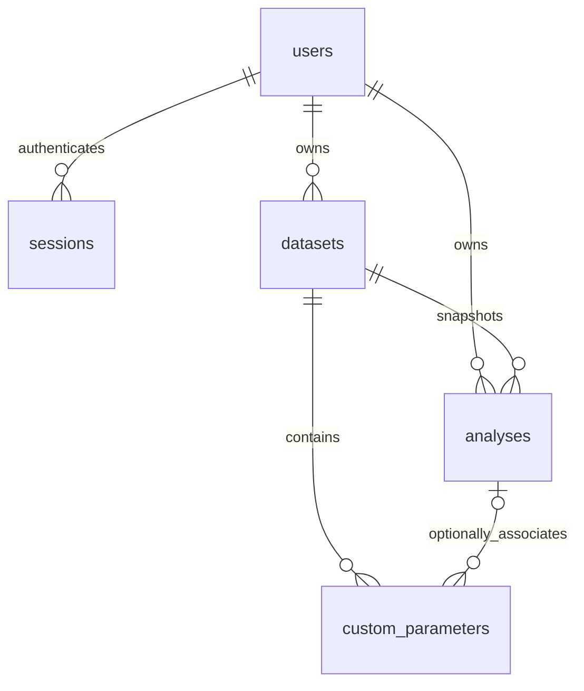

# Architecture

## Repository audit

The original project comprised `server.py`, `hrml`, `test_server.py`, and `accounts.sqlite3`. Its standard-library HTTP server only supported signup/login/logout/me, with two tests. One existing user and one session were found. The original baseline passed both tests with network permission. Existing worktree changes and IDE metadata were left intact; account secrets and DB contents are not tracked.

## Components

| File | Responsibility |
|---|---|
| `server.py` | Preserved launch command and exported app/password helpers |
| `app_backend.py` | Flask REST routes, ownership, validation, CSRF, session cookies, rate limiting, Waitress lifecycle |
| `database.py`, `migrations/` | Per-request SQLite connections, additive transactional migrations, online backups |
| `statistics_engine.py` | Validated numerical calculations, metric catalogue, reproducibility conventions, grouped expansion |
| `reports.py` | Saved-analysis PDF generation, histogram, paginated tables and methodology |
| `hrml`, `static/app.js`, `static/style.css` | Vanilla frontend with hash-routed pages and escaped HTML |
| `static/vendor/` | Pinned Plotly library and license, installed by npm or built inside Docker |
| `scripts/` | Browser workflow verification and explicit database maintenance |

Flask and Waitress replace the development-only transport rather than the account model or frontend stack. The app remains Python + HTML/CSS/JavaScript + SQLite. Plotly supports all requested charts, including box plots, and is served locally for offline LAN use. Numerical calculations use Python's standard library, avoiding a heavy NumPy/SciPy runtime where it is not needed.

## Storage model

Original `users(id,username,email,salt,password_hash)` and `sessions(token_hash,user_id,expires)` columns are unchanged. Migration 001 adds datasets, analyses, custom parameters, login-attempt counters, and indexes; `schema_migrations` records applied scripts.

Bounded dataset columns and rows are stored as one validated JSON document. At 100,000 cells maximum this keeps row order, text columns, missing cells, and grouped records together in an atomic revision. Per-cell relational queries are not a required workflow. Analysis JSON stores all computed results, null explanations, formulas, conventions, version, settings, summary, and chart data. The associated snapshot stores the exact input data, title, and description.

Changing dataset observations increments its revision; renaming or describing a dataset does not. Updates require the last seen revision and use a conditional SQL update to prevent lost concurrent edits. Saved analyses keep their original results and snapshots, and derive historical/current status by comparing revisions. Automatic preview calculations are transient; saving an analysis recomputes results on the server instead of trusting client values.

Custom parameters are separate mutable records with creation/modification timestamps, optional analysis association, and typed JSON values. Recalculations never update them. Reports explicitly identify their latest saved state at export time. Deleting an analysis releases its associated parameters to dataset scope; deleting a dataset explicitly cascades its analyses and parameters. Duplication of a dataset copies data and dataset-scoped parameters; duplication of an analysis copies its immutable snapshot and analysis-scoped parameters.

## Security and lifecycle

- PBKDF2-SHA256, 600,000 rounds, random 16-byte salts preserve the original hashes.
- Session tokens are random, stored only as SHA-256 hashes, HttpOnly/SameSite=Strict. Server expiry is 12 hours or 30 days; remember-me sets cookie Max-Age. Password changes invalidate every session.
- All mutations, including login/signup/logout, require a signed double-submit CSRF token, verified against an HttpOnly cookie; token is obtained from `/api/me`. Token signing expiry is two hours. Origin is checked when supplied.
- Each resource operation checks the authenticated owner. Foreign private IDs return 404. Structured IDs and settings are validated; all user SQL values are parameterized.
- Account attempts are persisted, with 10 identifier attempts and 30 IP attempts per 15 minutes. Successful logins also count toward the window. Proxy headers are trusted only for an explicitly configured proxy IP.
- Host allowlisting, security headers/CSP, body limits, safe CSV cells, escaped UI text, and escaped PDF text protect common input/export paths. Only the public `static/` directory and the exact `hrml` file are served.
- SQLite uses WAL, foreign keys, busy timeout, and separate request connections. `database.backup` uses SQLite's online backup API.
- Waitress binds to the configured host; Docker sets 0.0.0.0. SIGINT/SIGTERM stop the server and wait up to 25 seconds for active worker requests. Logs contain route/method/status and server exceptions, not passwords or session tokens.

## Statistical policy

Percentiles use Hyndman-Fan type 7. Variances label denominators N versus n-1. Adjusted Fisher-Pearson skewness requires n>=3 and nonzero spread; bias-corrected Fisher excess kurtosis requires n>=4. Mode is null when no value repeats. CV is `100 * sample_std / abs(mean)`. Z-scores use population std; zero spread is undefined. Positive-only means reject their domain by returning null explanations. Correlation uses paired rows, average ranks for ties, and OLS regression. R² is undefined for constant Y. Grouped value frequencies are expanded exactly within 10,000 observations; class intervals use midpoint estimates. Missing selected cells are rejected or explicitly dropped. Numeric precision limits are documented in the README.
